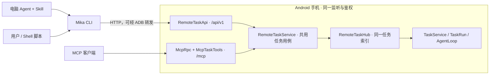

# 电脑端 CLI 与 Agent Skill

[English](cli.en.md)

CLI 与 MCP 是并列入口,共用手机端的远程任务服务。CLI 调用普通 HTTP 任务 API,不需要 MCP SDK、握手、工具发现或 MCP 客户端配置。Skill 告诉电脑 Agent 怎样使用 CLI、处理追问和报告真实结果;手机上的 Mika 仍负责规划和执行。



## 安装

需要 Python 3.10+ 和包含任务 API v1 的 Mika APK。旧 APK 只有 MCP 时,CLI 会明确提示不兼容。此功能随源码构建提供,不能仅凭已有 MCP 能力判断某个已发布 APK 支持它。

在仓库根目录使用 pipx 安装,或在自己的 Python 虚拟环境里使用 pip:

```bash
pipx install ./tools/mika
# 或在已激活的虚拟环境中:
python3 -m pip install ./tools/mika
mika --help
```

也可以直接运行 `python3 tools/mika/scripts/mika_cli.py --help`,不安装 Python 依赖。将整个 `tools/mika/` 目录复制到支持 Skills 的 Agent 的技能目录,并命名为 `mika`,即可安装电脑端 Skill。该目录带齐脚本和许可,单独复制后可运行;不依赖手机内部技能目录或另一个仓库检出。

## 连接手机

ADB 模式需要 Android platform-tools。数据线或已经配对并连接的无线 ADB 都可以;无线连接尚未出现在 ADB 中时,先按手机的无线调试页面完成配对/连接。

```bash
mika devices --json
mika connect --device SERIAL --json
mika doctor --device SERIAL --json
```

只有一个在线设备时可省略 `--device`;也支持已有的 ANDROID_SERIAL 环境变量。多设备不猜目标,连接失败也不切换到另一台手机。`connect` 调用 Mika 写到手机上的官方启动脚本,打开电脑连接并启动所需助手;此动作不提交业务任务。其余命令只读取当前连接。

每次调用重新读取当前令牌、端口和开机编号,申请自己的 `adb forward tcp:0` 临时端口,完成后只删除该转发。令牌只保存在进程内存中,启动脚本的原始输出不转发到终端。CLI 退出不关闭手机服务,也不停止正在执行的任务。

也可以使用手机设置里显式开启的局域网/私有网络连接:

```bash
mika --url http://PHONE:8765 --token-file /path/to/private-token-file doctor --json
```

令牌文件只包含访问令牌,由用户按私有文件保存。URL 使用服务器根地址或 `/api/v1`,不要填 `/mcp`;不允许 URL 内嵌凭据。CLI 不跟随 HTTP 重定向、不使用环境中的 HTTP 代理。服务器沿用私有网络限制;局域网 HTTP 的链路本身不加密,可使用 ADB 或可信私有组网。

## 任务命令

```bash
mika --device SERIAL task run --goal-file task.txt --json
mika --device SERIAL task status TASK_ID --json
mika --device SERIAL task wait TASK_ID --timeout 45 --json
mika --device SERIAL task answer TASK_ID --text-file answer.txt --json
mika --device SERIAL task cancel TASK_ID --json
mika --device SERIAL task list --limit 10 --json
```

简单文本也可用 `--goal` / `--text`;文件参数为 `-` 时读取标准输入。`run --conversation CONVERSATION_ID` 创建同一远程对话中的下一项任务,`answer` 只回答当前追问。保留现有对话的 mcp- 前缀以兼容已经发出的 ID;这个历史前缀不代表 CLI 走 MCP 协议。

`run` 返回任务 ID 即结束。`wait` 一次最多等待 50 秒,状态变化或任务结束时返回;如果已经在等回答或手机接管,立即交回。预算用完仍返回当前状态,不判失败、不取消、不重新提交。取消返回的 `accepted` 只表示请求已交给任务服务;必须查询到 cancelled 才能报告已经取消。

`--json` 将成功结果和错误都作为单个 JSON 对象写入 stdout;默认输出缩进 JSON,错误写入 stderr。连接选项和 `--json` 可以写在命令前后。可用 `--request-timeout` 调整 HTTP 超时;等待请求的读取预算至少是任务等待时间加 5 秒。

| 退出码 | 含义 |
| --- | --- |
| 0 | 调用成功;任务仍可能运行、等待用户或尚未完成取消。 |
| 1 | API 明确拒绝,或查询到任务 failed / cancelled。 |
| 2 | 输入、配置、连接或协议不兼容。 |
| 4 | 写入结果不明;可能已被手机接受,没有自动重试。 |
| 130 | 本地读取/等待被中断,没有请求取消手机任务。 |

响应丢失、写入遇到服务端错误、或写入过程中按 Ctrl-C 时,可能无法判断手机是否接受。已知任务 ID 就查同一任务;没有 ID 就查最近任务,仍不能确认则如实交回。查询失败也不自动重试。手机端任务索引仍在内存中,进程重启后可能找不到旧 ID;本 PR 不增加任务持久化或幂等提交保证。

`doctor` 只检查连接/API 和可用的设备状态,`model_configuration` 明确为 unverified。它不会调用模型或提交任务,也不能证明真实手机操作已经验收。结果缺少 `verified` 时表示核实情况未知。付款确认、手机接管和手机本地任务的访问边界与 MCP 共用同一套规则。

## HTTP 契约

以下路径都在 `/api/v1` 下,使用同一 Bearer 认证;POST 正文是 application/json 对象。API 通过结构化错误的 code/message 和 HTTP 状态返回失败,不返回 MCP 信封。未知字段会被拒绝。

| 方法与路径 | 输入 / 返回 |
| --- | --- |
| GET 根路径 | API 版本、服务器版本、能力和输入上限。 |
| GET /device | 只读设备状态;未提供设备接口时返回 503。 |
| POST /tasks | goal、可选 conversation;201 返回任务状态和 ID。 |
| GET /tasks?limit=10 | 最近远程任务;limit 范围 1–50。 |
| GET /tasks/ID | 当前任务状态。 |
| POST /tasks/ID/wait | timeout_s 范围 1–50,默认 30;返回状态与 changed。 |
| POST /tasks/ID/answer | text;返回 task_id 与 accepted。 |
| POST /tasks/ID/cancel | 空对象;接受时 202,终态任务 200,返回 accepted。 |

业务校验失败为 400,任务不存在为 404,当前状态不能回答为 409,任务服务拒绝启动为 503。认证、来源和限流策略与 `/mcp` 共用。两种入口使用同一远程任务索引;持有同一访问权限的客户端可以跨入口查询和操作远程任务,仍不能访问手机本地发起的任务。

## 开发验证

```bash
./gradlew :core:test :core:cliTest :app:testDebugUnitTest :app:assembleDebug
# Python 可单独运行;指定解释器可用 -PmikaPython=/path/to/python3
python3 -m unittest discover -s tools/mika/tests -v
```

纯 JVM 测试覆盖共享服务、API/MCP 互操作、鉴权、状态与原有协议回归。`cliTest` 运行真实 CLI 对 Kotlin HTTP 服务的契约测试(关闭 MCP 路由),以及假 ADB、丢响应、令牌变化、端口清理和独立 Skill 目录测试。这些都不需要真机或模型 Key。真机无线断连、手机重启和真实 Agent 执行需要另行验收,不能用这些隔离测试代替。
